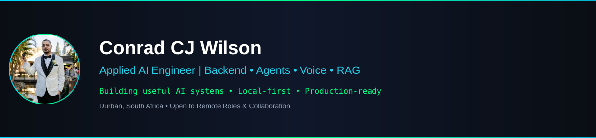

  

## About Me

AI Engineer building production systems across backend APIs, multi-agent orchestration, semantic pipelines, and observability — deployed on constrained hardware with zero cloud spend. 

Background includes eight years in technical operations and sales at **Makro South Africa**, one of Southern Africa's largest retailers. I focus on shipping local-first, production-ready AI systems with explicit contracts, observability, and failure recovery.

Open to **remote AI engineering roles**, **consulting**, or **collaboration** on local-first AI infrastructure.

## Tech Stack

## Featured Projects

| Project | Description | Tech |
| :--- | :--- | :--- |
| **[corp-recon-engine](https://github.com/cjps4linux-creator/corp-recon-engine)** | Corporate reconnaissance engine for structured data gathering and analysis with hardened workflows. | `Python` `FastAPI` `Automation` `Security` |
| **[ghost-data-suite](https://github.com/cjps4linux-creator/ghost-data-suite)** | Hardened encrypted web scraping and monitoring stack with Flask + SocketIO, Prometheus metrics, backup/restore, and key rotation. | `Flask` `SocketIO` `Prometheus` `Encryption` |
| **[documind](https://github.com/cjps4linux-creator/documind)** | AI document intelligence platform with RAG, FastAPI, Celery/Redis workers, pgvector, and faithfulness evaluation harness. | `FastAPI` `RAG` `pgvector` `Celery` `Redis` |
| **[athena-voice](https://github.com/cjps4linux-creator/athena-voice)** | Real-time speech-to-speech voice agent with WebSocket streaming, server-side VAD, barge-in handling, and sub-2s latency. | `WebSocket` `Whisper` `VAD` `TTS` `LLM` |
| **[liquid-audio-gui](https://github.com/cjps4linux-creator/liquid-audio-gui)** | CPU-only local voice chat server with browser GUI. Faster-Whisper STT, LM Studio integration, edge-tts, optimized for constrained hardware. | `Faster-Whisper` `LM Studio` `Edge-TTS` `WebSocket` `Gradio` |

## Currently Exploring

- 🧠 **Large Language Models (LLMs)** & Agentic Systems
- 🔎 **Retrieval-Augmented Generation (RAG)** & Evaluation Frameworks
- ☁️ **Local-first AI Infrastructure** & MLOps
- ⚡ **High-Performance Backend Engineering**
- 🤖 **Multi-Agent Orchestration** & Contract-Driven Design

## Achievements & Certifications

- **Microsoft 365 Accreditation** - ExpertZone/Microsoft (2020, 2022)
- **Microsoft Surface Accreditation** - ExpertZone/Microsoft (2020)
- **Microsoft Windows Accreditation** - ExpertZone/Microsoft (2020)
- **Diploma in Information Technology** - Oval International Computer Education (Completed Dec 2018)

## GitHub Stats

  

## Connect

  Building useful AI systems, one commit at a time.

